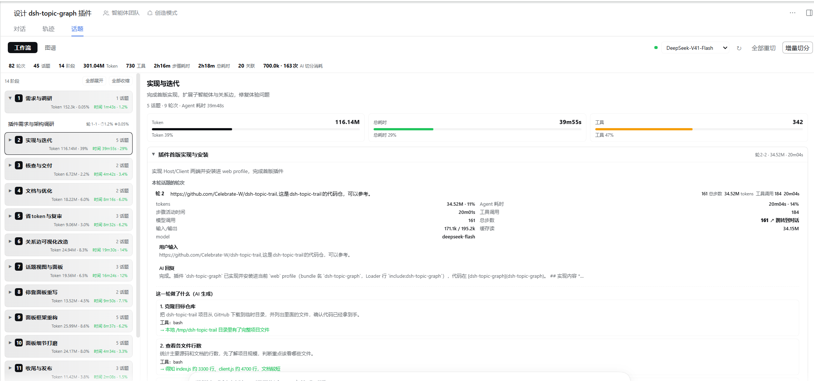
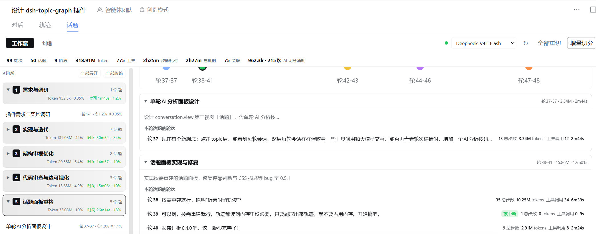
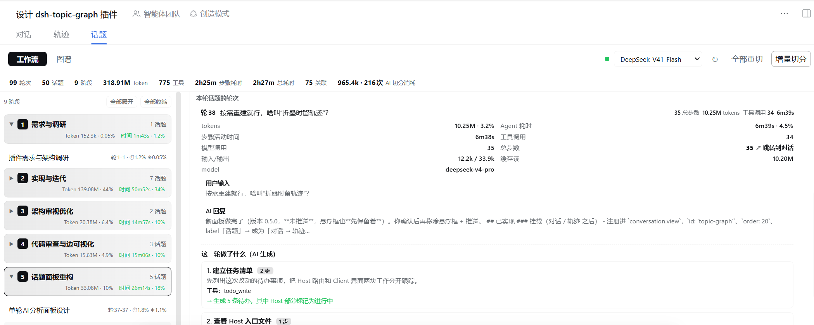
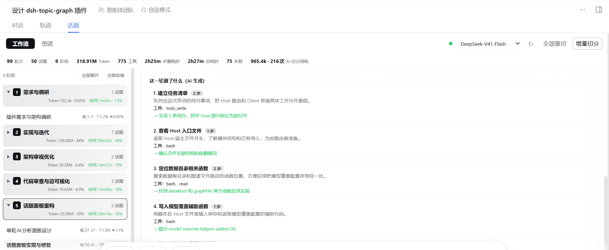
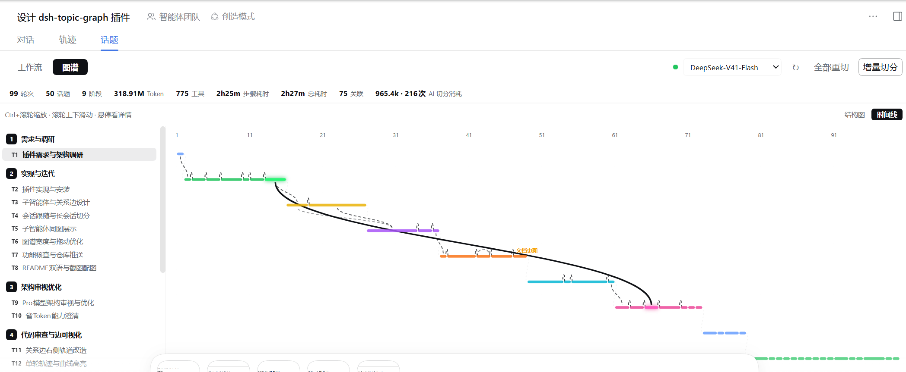
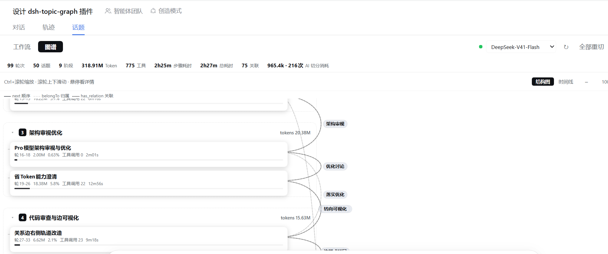

# dsh-topic-graph

[](https://www.npmjs.com/package/dsh-topic-graph)
[](https://www.npmjs.com/package/dsh-topic-graph)
[](https://github.com/hagen666/dsh-topic-graph)
[](https://awesome-dsh-plugin.com/p/hagen666/dsh-topic-graph/)

> Session topic graph — split every conversation into turns, let AI incrementally cluster them into topics and stages, and see where tokens, tools, and time actually went.

[中文](README.md) | **English**

`dsh-topic-graph` is a Web UI plugin for [dsh](https://github.com/deepseek-ai) (DeepSeek Harness). It listens to the dsh session event stream, splits each session into **turns**, then asks DeepSeek to **incrementally** cluster turns into **topics** and topics into **stages**, naming both. **Subagent sessions** spawned by a session are segmented too and drawn as branches in the very same graph.

The plugin docks as a **Topics** view right after "Conversation" / "Trajectory", with two views:

- **Topics · Workflow**: a stage → topic tree on the left, and the selected stage's detail on the right (overview stats, expandable topic cards, turn details and per-turn AI analysis);
- **Topics · Graph**: two views — **Timeline** (X = turn/time, Y = stage lanes; topics are colored bars, relations are curves) and **Structure** (stage → topic tree plus a relation rail), with Ctrl+wheel zoom and hover details.

The fixed top bar shows session stats (tokens / step time / tools / turns / topics / stages / relations / AI cost) and lets you pick the segmentation model and trigger segmentation.

## Screenshots

### Workflow: stage overview & in-stage topic relations



*Stage tree on the left (collapsible, with token/time ratios); on the right: stage stats (tokens / wall time / tool ratio bars), the **in-stage topic relations** mini chart (X = turn, dots = topics, dashed curves = relations), and expandable topic cards.*

### Workflow: topics and turns



*Expanding a topic card lists its turns: turn number, a preview of the user input, total steps / tokens / tool calls / wall time.*

### Workflow: turn detail



*Expanding a turn shows tokens (in / out / cache read / cache write), step activity time, tool calls, total steps and model, plus the user input / AI reply with a "jump to conversation" action.*

### Workflow: per-turn AI analysis



*On demand, the model/tool trace of a turn is rewritten as a plain-language step-by-step explanation (each step annotated with its step count); results are cached and can be re-analyzed.*

### Graph: Timeline



*X axis = turn (time), Y axis = stage lanes; topics are colored bars positioned by their turn span, and semantic relations are faint dashed curves (highlighted on hover / click), linked with the left outline.*

### Graph: Structure



*Stage → topic tree with relation curves on the right rail; stages are collapsible, hover a node for details and click to open the topic detail.*

---

## Why

The hardest question in a long session is "where does this stand, where did the time go, and where was that conclusion?" Chat history is linear; actual work is a graph. This plugin folds a linear session into a navigable work map:

- Per-turn stats: **tokens (input / output / cache read / cache write), tool calls, agent time**;
- AI clusters turns into topics and topics into stages, and detects relations such as depends-on / continues / contrasts / fixes / verifies / **revisits**;
- Subagents are no longer hidden in another session: they appear as branches under the parent topic, with comparable tokens and time;
- Open any topic's detail and jump straight back to its first turn in the conversation.

## Features

### Segmentation & stats

- **Turn-based**: one turn = `turn/start` ~ `turn/end`; stores user input, assistant reply, token usage, tool calls (counts / distribution / errors), turn duration (sum of per-turn durations, not last-minus-first), and step active time.
- **AI topics & stages**: DeepSeek groups consecutive turns into a work thread (topic) and adjacent topics into a stage, with names and summaries.
- **Subtopics up to 3 levels**: AI decides whether a subtopic is worth creating (e.g. a submodule, a dedicated bug hunt); depth is hard-capped at 3 (root = level 1), deeper nodes are flattened by the Host.
- **Incremental segmentation**: when new turns arrive, only the new turn summaries + the existing topic/stage structure are sent; historical turn bodies are never re-sent. Long sessions are imported in batches, showing results as they are produced.
- **Long-session / 400 resilience**: 6 turns per request by default; a failed request halves the batch (6→3→1) and remembers a working batch size; 400-class errors retry once with the adapter's default reasoning effort; the output cap scales with topic count, truncated structure JSON is retried with a larger cap and detected so a half structure is never applied; after repeated failures it degrades to local fallback instead of burning tokens.
- **Shares**: every topic / stage / turn shows token share, tool-call share, and agent-time share; the top strip shows totals (turns, topics, stages, tokens, tools, step time, wall time, relations, subagent tokens).

### Graph & relations

- **Typed edges**:
  - `next` — chronological chain between adjacent root topics;
  - `belongTo` — topic belongs to a stage / subtopic belongs to its parent / subagent topic belongs to its branch;
  - `has_relation` — AI-judged semantic relation (depends-on / continues / contrasts / fixes / verifies / revisits…), with a label;
  - `delegates` — parent topic → subagent branch.
- **Title-only relation pass**: after segmentation, a cheap analysis over **topic titles only** detects links and especially the **A → B → A revisit** pattern; configurable via `relationMode` (`titles` / `inline` / `off`).
- **Subagents in the same graph**: subagent sessions are segmented automatically and rendered as a branch box with their own topic tree; click the branch header to open that subagent session, click a child topic for its detail. Nested delegation (subagent of a subagent) is supported too.

### UX

- **Follows the sidebar**: reads the shell-persisted current-session selection (`dsh.sessions.current`), so switching workspace/session on the left updates the graph automatically; the panel dropdown can pin a session, and a pinned subagent session survives left-side switches.
- **Topic detail**: ⓘ on a chain card or a click on a graph node opens a detail overlay (token breakdown, tool distribution, durations, relations, parent/children, subagent branches).
- **Jump to first turn**: the detail footer's “Open first turn in chat” switches to the session and tries to scroll to the topic's first turn (falls back to opening the session when history is not fully loaded).
- **Graph controls**: Ctrl+wheel zooms around the cursor, plain wheel scrolls, hover shows a full tooltip; the ▾/▸ arrows on stages / topics / subagent branches collapse their content, while clicking elsewhere on a node opens its detail.
- **Floating panel**: ~900px wide by default, resizable up to nearly the viewport width; when collapsed into a pill it can still be dragged, and a tap expands it.
- **Theme & locale**: only `--dsw-alias-*` theme tokens (light/dark aware); all visible text goes through the dsh locale service (Chinese / English).

### Engineering

- **No build step**: the Client half is plain React + `h()` with React provided by the dsh runtime; refresh the page after editing. Host changes need a dsh restart.
- **The log is the source of truth**: turn stats are rebuilt from the session log (`ctx.sessionQuery.readSession`), live sessions are folded incrementally from `session/event` and deduped by `seq`; AI only decides the structure.
- **Lightweight persistence**: only topics/stages/relations plus "segmented through turn" are persisted to `<DSH_HOME>/data/topic-graph/<sessionId>.json` (atomic, debounced); restored on restart and segmentation continues.

## Install

Requires a working dsh Web profile.

### Option 1 (recommended): install from dsh-market / the plugin market

Search `dsh-topic-graph` in dsh's **plugin market** and click **Install**. Plugin page:
👉 [awesome-dsh-plugin.com/p/hagen666/dsh-topic-graph](https://awesome-dsh-plugin.com/p/hagen666/dsh-topic-graph/)

### Option 2: install from npm with the dsh CLI

```bash
dsh plugin --profile web add dsh-topic-graph
```

Update to the latest version:

```bash
dsh plugin --profile web update dsh-topic-graph@latest
```

### Option 3: install from GitHub

```bash
dsh plugin --profile web add github:hagen666/dsh-topic-graph
```

### Option 4: local development

```bash
git clone https://github.com/hagen666/dsh-topic-graph.git
cd dsh-topic-graph
dsh plugin --profile web add file:/absolute/path/to/dsh-topic-graph
```

Then **restart dsh** (Ctrl-C in the terminal running `dsh web`, start it again) and refresh the browser page.

> The plugin registers Host rows via `dsh.bundle.patch` and declares the Web client via `dsh.client`; no extra build is needed — `lib/client.js` is the browser bundle. The npm package is prebuilt, so installing it does not trigger an `allowBuilds` approval.

## Configuration

Configure under `config` in `cordis.patch.yml` (or override in your profile patch layer):

| Key | Meaning | Default |
| --- | --- | --- |
| `segmentMode` | `auto` (AI first, rule fallback) / `llm` (AI only) / `rule` (rules only, zero cost) | `auto` |
| `provider` / `model` | Model route for segmentation; auto-detected when empty | `deepseek-official` / `deepseek-flash` |
| `batchTurns` | Turns per model request (halved automatically on failures) | `6` |
| `maxInputChars` | Character cap for new-turn summaries per request | `8000` |
| `debounceMs` | Debounce after a turn ends before segmenting (ms) | `2500` |
| `minGapMs` | Minimum gap between two AI segmentations of one session (ms) | `8000` |
| `autoSegment` | Incrementally segment automatically when new turns arrive | `true` |
| `showSubagents` | Show subagent sessions in the session list (branches are always included) | `false` |
| `includeSubagents` | Include subagent sessions in segmentation and branches | `true` |
| `maxSubagentDepth` | Max recursion depth of subagent branches (1–5) | `2` |
| `maxBranches` | Max branches returned per graph request (1–60) | `20` |
| `relationMode` | Relation detection: `titles` (title-only, default) / `inline` (from segmentation) / `off` | `titles` |
| `reasoningEffort` | Reasoning effort for segmentation `off/low/high/max`; retried with default on 400 | `off` |
| `ruleTurnsPerTopic` | Turns per topic in rule mode | `3` |
| `ruleTopicsPerStage` | Topics per stage in rule mode | `5` |

## Usage

- **Chain tab**: stage card → topic card (expandable to turn details); click a turn row to see token breakdown, tool distribution, model, input/reply previews; topics show related-topic chips and subagent groups.
- **Graph tab**: stage containers + topic/subtopic tree + subagent branches on the right; Ctrl+wheel zoom, wheel scroll, hover for full info, click a topic for details.
- **Topic detail**: token breakdown/shares, tool distribution, step time, relations, parent/children/subtopics/subagent branches; footer button jumps to the first turn.
- **Subagents**: click a branch header to open that subagent session; click a child topic for its detail; the detail view can navigate back to the parent session.
- **Session picker**: follows the sidebar current session by default; pick a session to pin it, or choose “Follow sidebar session” to resume following.

## How it works

```
session/event ─┐
               ├─► turn fold (turns) ─► incremental AI segmentation ─► topics / stages / relations
readSession  ──┘                                                    └─► subagent branches
                                                                          │
                                          webServer REST ────────────────┴──► /plugins/topic-graph/*
                                                                          │
                                          shell.overlay floating panel (chain / graph)
```

- **Host half** (`lib/index.js`): event folding, turn stats, incremental AI segmentation (prompting / validation / fallback / adaptive batching), relations and subagent branches, persistence, HTTP routes.
- **Client half** (`lib/client.js`): registers the `conversation.view` "Topics" view, polls the Host, renders Workflow and Graph (Timeline / Structure) views, the detail overlay and jump actions.
- AI output is validated by the Host: turns must be covered exactly once, parent links must exist and be acyclic, subtopic depth ≤ 3, every topic must belong to a stage; invalid parts are fixed or rolled back, and truncated JSON is repaired where possible.

### HTTP routes

| Route | Meaning |
| --- | --- |
| `GET /plugins/topic-graph/ping` | Health check (returns plugin version) |
| `GET /plugins/topic-graph/sessions` | Session list (title, last activity, whether segmented) |
| `GET /plugins/topic-graph/graph?sessionId=&version=` | Full graph for a session (turn stats + topics + stages + relation edges + subagent branches + AI status); returns `{unchanged:true}` when `version` is unchanged |
| `POST /plugins/topic-graph/segment` | Trigger segmentation `{sessionId, full}`; `full:true` re-segments everything |

### Data & persistence

- Turn stats are not persisted: they are rebuilt from the dsh session log, which is the source of truth.
- The segmentation structure is persisted to `<DSH_HOME>/data/topic-graph/<sessionId>.json` — only topics/stages/relations and "segmented through turn"; restored on restart and extended incrementally.
- New turns (`turn/end`) trigger a debounced background segmentation even while the panel is collapsed.

## Known limitations

- Turns interrupted without a `turn/end` in the log are treated as “running” until dsh's log repair closes them.
- “Open first turn in chat” locates the turn via the chat's `data-chat-turn` DOM marker; it is best-effort — when older history is not loaded it only opens the session.
- Following the sidebar uses the shell's persisted `dsh.sessions.current` key; if dsh changes that implementation, the plugin falls back to the Host's “most recently active session”.
- A subagent's parent topic is inferred from the turn active when the child started (the AI does not re-read child bodies); use “Re-segment all” to regenerate if needed.
- Subagent sessions call the model for their own segmentation; control cost via `includeSubagents`, `maxBranches`, and `minGapMs`.
- Very long sessions produce large graph payloads (hundreds of KB for hundreds of turns); the client skips unchanged polls via `version`. All traffic stays on localhost.

## Development

```bash
# edit lib/client.js: refresh the browser page (no build)
# edit lib/index.js (Host half): restart dsh
```

Layout:

```
lib/index.js      Host: event folding, turn stats, AI segmentation, relations/branches, persistence, REST
lib/client.js     Client: conversation.view panel (Topics · Workflow / Topics · Graph)
cordis.patch.yml  dsh bundle registration and default config
locale/           plugin display name and description (zh / en)
assets/           README screenshots
icon.svg          plugin icon
```

## Changelog

- **0.6.41** — Workflow mini timeline: no edges between adjacent topics at all (only non-adjacent relations remain).
- **0.6.40** — Workflow mini timeline dot labels now show the turn range (轮X-Y).
- **0.6.39** — Workflow mini timeline dot labels use T1/T2….
- **0.6.38** — Workflow mini timeline: a single relation between adjacent topics is hidden.
- **0.6.37** — Main timeline: a single relation between adjacent topics is hidden (avoids duplicating `next`).
- **0.6.36** — Relation mining rework: cap 1.5N, merge (not overwrite) segmentation relations, include subtopics, include summaries, add extension edges (parent → child), orphan second pass; revisit excludes parent-child pairs.
- **0.6.35** — In-stage relations: overlapping arcs are stacked into layers.
- **0.6.34** — In-stage relations: dot labels use the topic title (truncated to 10 chars).
- **0.6.33** — Added the "in-stage topic relations" mini timeline to the workflow stage detail.
- **0.6.32** — Timeline relation lines get a wider invisible hit area; hover resets on scroll; SVG overflow visible.
- **0.6.31** — Bottom padding (150px) for the structure/timeline scroll areas so the composer no longer covers content.
- **0.6.30** — Structure main column capped at 660px and nodes at 560px.
- **0.6.29** — Structure canvas now fits the viewport width; subagent branch gap increased to 26px.
- **0.6.28** — Larger vertical gap between subagent branches (12→22px).
- **0.6.27** — Timeline: removed duplicated stage names from lanes; hovering a bar highlights the matching outline topic.
- **0.6.26** — Timeline: topic bars have a 6px minimum width (no more dots); relation lines slightly brighter; same-stage relations show the line but hide the label by default.
- **0.6.25** — Keep same-stage relation lines but hide their labels by default; fixed CSS order so highlights turn solid.
- **0.6.24** — Same-stage relation labels hidden by default (only shown when highlighted).
- **0.6.23** — Relation labels fainter by default; only the hovered/selected relation shows its label, others hide.
- **0.6.22** — Relation lines are faint dashed by default; labels are staggered along the curve and shifted right; click a line to pin the highlight, click elsewhere to clear.
- **0.6.21** — Renamed "AI segment" to "Incremental segment"; added a deterministic "revisit" fallback (auto edge when topic titles are ≥0.7 similar).
- **0.6.20** — Tighter structure nodes with more vertical gap; timeline uses thin bars with per-stage colors and no arrowheads.
- **0.6.19** — Structure nodes 44px tall / 16px gap; timeline auto-fits the viewport, topics become thin bars/dots, smaller fonts.
- **0.6.18** — Fixed stage boxes overlapping the relation rail / subagent column; fixed edge layering so edges are no longer hidden.
- **0.6.17** — Graph tab defaults to the Timeline view; header adds a "Structure / Timeline" switch.
- **0.6.16** — Added the Timeline (Gantt) view, replacing the swimlane; removed the topic matrix.
- **0.6.15** — Added experimental swimlane and topic-matrix views.
- **0.6.14** — Final colors: stage headers use a brand gradient (9%→4%), selected topics use a 3% tint with no left bar.
- **0.6.13** — Selected topic tint 3%, left bar removed.
- **0.6.12** — Stage headers use a brand gradient again; selected topics fainter.
- **0.6.11** — Distinguished stage/topic colors (neutral stage + brand stripe, later adjusted).
- **0.6.10** — Removed the logo and session title from the top bar; moved the Workflow/Graph toggle to the far left and enlarged it.
- **0.6.9** — Fix linked scrolling in the workflow view: measure and lock the panel height so the top bar stays fixed and the two columns scroll independently.
- **0.6.8** — Tried constraining dsh's conversation view container via CSS `:has()` (did not fully work).
- **0.6.7** — Moved the Workflow/Graph toggle into the stats strip as small buttons; header now reads "Topics: <session title>"; switching stage/topic scrolls the right pane back to top.
- **0.6.6** — Moved the status dot to the far right next to the model selector.
- **0.6.5** — Turn collapse hot zone is now "turn number + title"; clicking detail/stats no longer collapses.
- **0.6.4** — Removed the light background from stage metrics; turns collapse only from the title; per-step step counts in the turn AI analysis.
- **0.6.3** — Collapsible stages (per-stage arrow + expand/collapse all), right-aligned stage metrics, fainter selected-topic background; turn rows show total steps; the AI analysis marks and links the turn's step count.
- **0.6.2** — Workflow refinement: two-line stage cards (title + token/time ratios), topic rows show ratios, single-topic selection fixed; stage stats with ratio bars; card collapses from the title; model selector moved right.
- **0.6.1** — The workflow right pane is now a stage detail with expandable topic cards (no more popup).
- **0.6.0** — Removed the floating panel (`shell.overlay`); the `conversation.view` "Topics" view is now the only panel.
- **0.5.0** — New docked "Topics" view after conversation/trajectory; "Chain" → "Topics · Workflow" with a two-column layout; "Graph" → "Topics · Graph"; AI segmentation/relations/turn analysis can use a dsh model (`/models` + `/model` override).

- **0.4.0** — New per-turn AI analysis: in a turn's detail, click “AI analyze” to rebuild that turn's model/tool trace on demand (nothing kept in memory) and generate a plain-language step-by-step how-to; the result is persisted and can be regenerated with “Re-analyze”.
- **0.3.7** — Graph relation edges redesigned: relation / sequence / delegate edges run through a dedicated right-hand rail as smooth curves that never cross nodes; click a line or its label to highlight it (cyan), click elsewhere to clear.
- **0.3.6** — Fix residual O(n²) in `buildGraphPayload` (reuse indexes for topic depth and child ids).
- **0.3.5** — AI segmentation cost chip always visible (even when 0); client version badge in the footer to verify refresh.
- **0.3.4** — `/graph` sends turn-text previews only (smaller payload); session-graph LRU with disk backing; parallel subagent branch import; parent cards marked “incl. subtopics”; collapse/zoom persisted; AI segmentation cost & progress; explicit error when the batch cap is hit; code-point-safe truncation; queued next-turn prompt attribution.
- **0.3.3** — Collapsible graph nodes: stages, topics, and subagent branches get a ▾/▸ arrow (click the arrow to collapse, click elsewhere to open details).
- **0.3.2** — Fix `[object Object]` in chain topic token metrics; when structure JSON is truncated, retry with a larger output cap and detect truncation to avoid applying half a structure.
- **0.3.1** — Discover subagent lineage even when `/graph` is requested before `/sessions`; test hooks and version bump.
- **0.3.0** — Inline subagent branches in the main graph, title-only relation analysis (incl. revisits), topic detail with jump-to-first-turn, global stats strip, ≤3-level subtopics, wider panel and draggable collapsed pill.
- **0.2.x** — Title-based relations, AI 400 adaptive splitting and diagnostics, stats strip and depth limit.
- **0.1.0** — First release (turn splitting, incremental AI topics/stages, chain & graph views, subagent branches).

## License

MIT.
