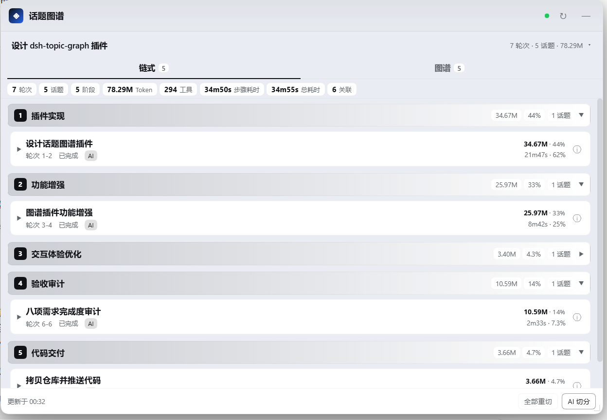
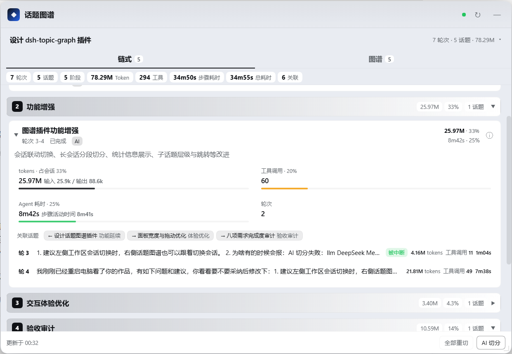
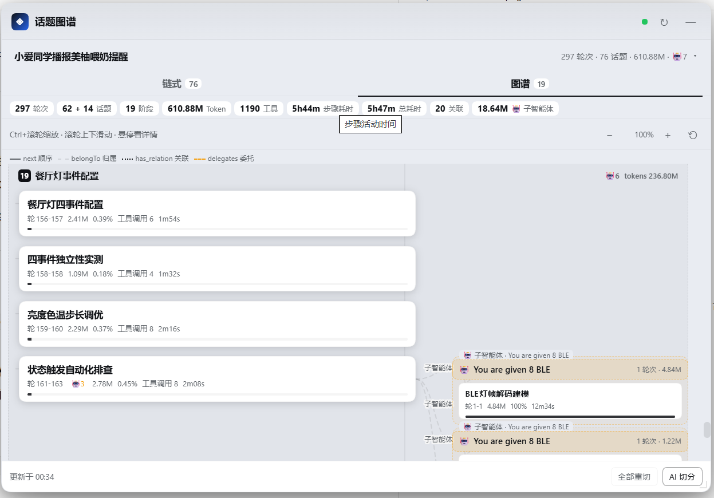

# dsh-topic-graph

> 会话话题图谱 —— 把每个会话按轮次切开，让 AI 增量聚合成「话题 / 阶段」，一眼看清 token、工具与时间花在哪。

**中文** | [English](README.en.md)

`dsh-topic-graph` 是 [dsh](https://github.com/deepseek-ai)（DeepSeek Harness）的 Web UI 插件。它监听 dsh 的会话事件流，把每个会话按**轮次（turn）**切分，再调用 DeepSeek 把轮次**增量**聚合成**话题（topic）**、把话题聚合成**阶段（stage）**，并为阶段、话题生成名字。会话里启动的**子智能体会话**也会被切分，并以分支形式直接画进同一张图。

插件在 Web UI 右下角提供一个可拖动、可缩放、可收起的悬浮窗，包含两个视图：

- **链式**：阶段 → 话题（含子话题）→ 轮次明细；
- **图谱**：阶段 / 话题 / 子话题 / 子智能体分支的树状图，支持 Ctrl+滚轮缩放、滚轮滚动、悬停查看完整信息。

## 界面预览

### 链式视图



*阶段 → 话题 → 轮次；顶部是总量统计条（Token / 步骤耗时 / 工具 / 轮次 / 话题 / 阶段 / 关联）。*

### 话题展开



*点开话题可看 token 占比与输入/输出拆分、工具调用分布、Agent 耗时，以及每个轮次的明细。*

### 图谱视图



*阶段分组框 + 话题树 + 右侧「子智能体分支框」；阶段 / 话题 / 子智能体分支左侧的 ▾/▸ 可折叠内容，点击其它区域打开话题详情。*

---

## 为什么做它

长会话最难回答的问题是「这件事到底做到哪了、时间花在哪了、当时那段结论在哪儿」。聊天记录是线性的，工作线索却是网状的。这个插件把线性会话折叠成一张可跳转的「工作地图」：

- 按轮次统计 **token（输入/输出/缓存读/缓存写）、工具调用、Agent 耗时**；
- 用 AI 把轮次聚成话题、把话题聚成阶段，并识别话题之间「依赖 / 延续 / 对比 / 修复 / 验证 / 回访」的关系；
- 子智能体不再藏在另一个会话里，而是作为分支挂在父话题下，token/耗时一起可比较；
- 点任意话题可以打开详情，并一键跳回该话题的首轮对话。

## 特性

### 切分与统计

- **按轮次切分**：以 `turn/start` ~ `turn/end` 为一轮，统计每轮的用户输入、AI 回复、token 用量、工具调用次数/分布/错误数、轮次耗时（各轮时间之和，而非首末轮次差）、步骤活动时间。
- **AI 话题 / 阶段**：DeepSeek 把连续轮次聚合成一条工作线（话题），把相邻话题聚合成阶段，并命名、写摘要。
- **子话题不超过 3 层**：AI 判断是否需要子话题（例如大任务下的子模块、某个错误的专项排查）；层级上限 3（根话题算第 1 层），超出的由 Host 压平。
- **增量切分**：新轮次到达后，只把「尚未切分的新轮次摘要 + 已有话题/阶段结构」发给模型；历史轮次正文不会重复输入。长会话首次导入也按批增量切分，边切边显示。
- **长会话 / 400 容错**：默认 6 轮/请求；请求失败自动把当前批**减半重试**（6→3→1），并记住可用批次大小；400 类错误自动换适配器默认推理档位重试；输出上限按话题规模动态放大，结构 JSON 被截断时自动用更大上限重试并识别截断、避免把半截结构当成完整结果；连续失败快速降级为本地兜底，不会无限重试烧钱。
- **占比统计**：每个话题 / 阶段 / 轮次都给出 token 占比、工具调用占比、Agent 耗时占比；面板顶部还有全局统计条（总轮次、总话题、阶段数、Token 总数、工具总量、步骤总耗时、总耗时、关联数、子智能体 Token）。

### 图谱与关系

- **有类型的边**：
  - `next` —— 相邻根话题的时间顺序链；
  - `belongTo` —— 话题归属阶段 / 子话题归属父话题 / 子智能体话题归属分支；
  - `has_relation` —— AI 判断的语义关系（依赖 / 延续 / 对比 / 修复 / 验证 / 回访…），带关系名；
  - `delegates` —— 父话题 → 子智能体分支的委托边。
- **按标题判断话题关系**：结构切分后，单独用「话题标题」做一次轻量关系分析（成本很低），专门识别 **「先说 A，再说 B，又回到 A」** 的回访模式；可通过 `relationMode` 关闭或改为跟随切分输出。
- **子智能体与主智能体同屏**：子智能体会话自动切分，并在图谱中以「分支框 + 内部话题树」显示；点分支头可进入子会话单独查看，点子话题节点可打开子话题详情。多层委托（子智能体的子智能体）同样支持。

### 交互

- **跟随左侧会话**：读取 shell 持久化的当前会话选择（`dsh.sessions.current`），左侧工作区/会话切换时图谱自动跟随；也可在面板下拉框里固定查看某个会话，固定子会话时不受左侧切换影响。
- **话题详情**：链式话题的 ⓘ 或图谱节点点击 → 打开详情浮层（token 明细、工具分布、耗时、关联/父子/子话题/子智能体分支）。
- **跳回首轮**：详情底部「在对话中打开首轮」→ 切到对应会话并尝试滚动定位到该话题第一轮（历史未完全加载时退化为仅打开会话）。
- **图谱操作**：Ctrl+滚轮以光标为锚点缩放、普通滚轮上下滚动、悬停 tooltip 显示完整信息；阶段 / 话题 / 子智能体分支左侧的 ▾/▸ 箭头可折叠内容，点击节点其它区域打开详情。
- **悬浮窗**：默认宽约 900px，可拖右下角继续放大到接近窗口宽度；收起成小球后仍可拖动位置，轻点展开。
- **主题与文案**：只使用 `--dsw-alias-*` 主题 token（跟随明暗主题）；界面文案注册进 dsh locale 服务（中文 / English）。

### 工程

- **零构建**：Client 半是纯 React + `h()`，由 dsh 运行时提供 React，改完刷新页面即生效；Host 半改动需重启 dsh。
- **日志是唯一事实来源**：轮次统计每次从 dsh 会话日志（`ctx.sessionQuery.readSession`）重放，实时会话通过 `session/event` 增量折叠并按 `seq` 去重；AI 只负责结构划分。
- **持久化轻量**：只持久化话题/阶段/关系结构与「已切分到第几轮」，落在 `<DSH_HOME>/data/topic-graph/<sessionId>.json`（原子写、防抖）；重启后恢复并继续增量切分。

## 安装

要求：dsh（Web profile）已能正常运行。

```bash
# 1) 克隆仓库
git clone https://github.com/hagen666/dsh-topic-graph.git
cd dsh-topic-graph

# 2) 安装到 dsh 的 web profile（把路径换成你的实际路径）
dsh plugin --profile web add file:/absolute/path/to/dsh-topic-graph
```

然后**重启 dsh**（在运行 `dsh web` 的终端 Ctrl-C 后重新执行），刷新浏览器页面。

> 说明：本插件通过 `dsh.bundle.patch` 注册 Host 行、通过 `dsh.client` 声明 Web 启用，不需要额外构建步骤；`lib/client.js` 即浏览器 bundle。

## 配置

配置写在 `cordis.patch.yml` 的 `config` 中（安装后也可以在你的 profile patch 层覆盖）：

| 键 | 说明 | 默认 |
| --- | --- | --- |
| `segmentMode` | 切分方式：`auto`（AI 优先，失败回退规则）/ `llm`（强制 AI）/ `rule`（仅规则，零成本） | `auto` |
| `provider` / `model` | 切分用的模型路由；留空则自动探测 dsh 当前配置 | `deepseek-official` / `deepseek-flash` |
| `batchTurns` | 每次请求模型的轮次数（请求失败会自动再减半） | `6` |
| `maxInputChars` | 单次请求新轮次摘要的字符上限 | `8000` |
| `debounceMs` | 轮次结束后触发切分的防抖时间（毫秒） | `2500` |
| `minGapMs` | 同一会话两次 AI 切分的最小间隔（毫秒，控成本） | `8000` |
| `autoSegment` | 新轮次到达后是否自动增量切分 | `true` |
| `showSubagents` | 会话列表是否显示子代理会话（分支始终会纳入图谱） | `false` |
| `includeSubagents` | 是否把子智能体会话纳入切分与分支展示 | `true` |
| `maxSubagentDepth` | 子智能体分支最大递归层级（1~5） | `2` |
| `maxBranches` | 单次返回的最大分支数（1~60） | `20` |
| `relationMode` | 话题关系判断：`titles`（仅标题，默认）/ `inline`（跟随切分输出）/ `off` | `titles` |
| `reasoningEffort` | 切分调用推理档位 `off/low/high/max`；400 时会自动换默认档位重试 | `off` |
| `ruleTurnsPerTopic` | 规则模式每个话题的轮次数 | `3` |
| `ruleTopicsPerStage` | 规则模式每个阶段的话题数 | `5` |

## 使用

- **链式 Tab**：阶段卡片 → 话题卡片（可展开轮次明细）；点轮次行可看 token 明细、工具分布、模型、输入/回复预览；话题下显示关联话题 chips 和子智能体分组。
- **图谱 Tab**：阶段分组框 + 话题/子话题树 + 右侧子智能体分支；Ctrl+滚轮缩放，普通滚轮滚动，悬停看完整信息，点击话题看详情。
- **话题详情**：token 明细/占比、工具分布、步骤耗时、关联/父子/子话题/子智能体分支；底部可「在对话中打开首轮」。
- **子智能体**：分支框头部点击进入子会话；子话题节点点击看详情；详情里可返回父会话。
- **会话选择**：默认跟随左侧当前会话；下拉框可固定某个会话，选「跟随左侧当前会话」恢复跟随。

## 工作原理

```
session/event ─┐
               ├─► 轮次折叠（turns）─► 增量 AI 切分 ─► topics / stages / relations
readSession  ──┘                                  └─► 子智能体分支（branches）
                                                        │
                                     webServer REST ────┴──► /plugins/topic-graph/*
                                                        │
                                          shell.overlay 悬浮窗（链式 / 图谱）
```

- **Host 半**（`lib/index.js`）：会话事件折叠、轮次统计、AI 增量切分（提示词 / 校验 / 回退 / 自适应分批）、关系边与子智能体分支、持久化、HTTP 路由。
- **Client 半**（`lib/client.js`）：注册 `shell.overlay`，轮询 Host 数据并渲染两个视图、详情浮层与跳转。
- AI 输出会被 Host 校验：轮次必须恰好覆盖一次、父子关系必须存在且不成环、子话题深度 ≤3、阶段归属完整；不合法的部分会被修正或回退，模型输出带截断也能容错修复 JSON。

### HTTP 接口

| 路由 | 说明 |
| --- | --- |
| `GET /plugins/topic-graph/ping` | 健康检查（返回插件版本） |
| `GET /plugins/topic-graph/sessions` | 会话列表（标题、最近活跃时间、是否有切分） |
| `GET /plugins/topic-graph/graph?sessionId=&version=` | 某会话的完整图谱数据（轮次统计 + 话题 + 阶段 + 关系边 + 子智能体分支 + AI 状态）；`version` 未变时返回 `{unchanged:true}` |
| `POST /plugins/topic-graph/segment` | 手动触发切分 `{sessionId, full}`；`full:true` 为全部重切 |

### 数据与持久化

- 轮次统计不落盘：每次从 dsh 会话日志重放，日志是唯一事实来源。
- 切分结构落盘：`<DSH_HOME>/data/topic-graph/<sessionId>.json`，只保存话题/阶段/关系结构与「已切分到第几轮」；重启后恢复并继续增量。
- 新轮次到达（`turn/end`）时后台防抖触发增量切分，即使悬浮窗收起也会继续。

## 已知限制

- 会话日志里没有 `turn/end` 的异常中断轮次会被视为「进行中」，等 dsh 日志修复补齐后才参与切分。
- 「在对话中打开首轮」的滚动定位依赖聊天区 `data-chat-turn` DOM 标记，属于尽力而为：历史未完全加载时只会打开会话，不保证精确落位。
- 跟随左侧会话读取的是 shell 的本地持久化键 `dsh.sessions.current`；如果未来 dsh 改动该实现，会自动退回 Host 的「最近活跃会话」。
- 子智能体的「挂靠话题」按启动时间落在父会话哪一轮来推断（AI 不重复读子会话正文），必要时可「全部重切」重新生成。
- 子智能体会话也会独立调用模型切分；会话/子代理很多时可通过 `includeSubagents`、`maxBranches`、`minGapMs` 控制成本。
- 极长会话的图谱数据较大（数百轮约数百 KB），前端按 `version` 跳过未变化的轮询；数据全部走本机回环。

## 开发

```bash
# 修改 lib/client.js 后：刷新浏览器页面即可（无需构建）
# 修改 lib/index.js（Host 半）后：重启 dsh 生效
```

目录：

```
lib/index.js      Host 半：事件折叠、轮次统计、AI 切分、关系/分支、持久化、REST
lib/client.js     Client 半：shell.overlay 悬浮窗（链式 / 图谱 / 详情 / 跳转）
cordis.patch.yml  dsh bundle 注册行与默认配置
locale/           插件显示名与说明（中 / 英）
assets/           README 截图
icon.svg          插件图标
```

## 版本记录

- **0.3.7**：图谱关系边重设计——关系 / 顺序 / 委托边统一走右侧独立轨道、平滑曲线，不穿越节点；点击线条或标签高亮（青色），点空白取消。
- **0.3.6**：修复 buildGraphPayload 里残留的 O(n²)（topicDepth/childIds 复用索引）。
- **0.3.5**：AI 切分消耗 chip 常显（0 也显示）；底部增加 client 版本号便于确认刷新是否生效。
- **0.3.4**：`/graph` 轮次正文只发预览（payload 更小）；会话图 LRU（磁盘作底稿）；子智能体分支并行导入；父卡片标注「统计含子话题」；折叠/缩放状态持久化；AI 切分消耗统计与进度条；切分批次超上限显式报错；文本按 code point 截断；队列下轮消息归位。
- **0.3.3**：图谱页阶段 / 话题 / 子智能体分支增加折叠箭头（点箭头折叠内容，点其它区域打开详情）。
- **0.3.2**：修复链式话题卡片 token 指标显示为 `[object Object]` 的渲染 bug；长会话结构输出被截断时自动放大输出上限重试，并识别截断输出避免误用。
- **0.3.1**：`/graph` 单独先到达时也能发现子智能体血缘；测试钩子与版本号。
- **0.3.0**：子智能体分支内联到主图、按标题的关系分析（含回访）、详情跳首轮、顶部统计条、≤3 层子话题、面板加宽与小球拖动。
- **0.2.x**：按标题的关系分析、AI 400 自适应拆分与错误诊断、统计条与深度限制。
- **0.1.0**：首版（轮次切分、AI 增量话题/阶段、链式与图谱视图、子智能体分支）。

## 许可

代码采用 **MIT** 许可证。
